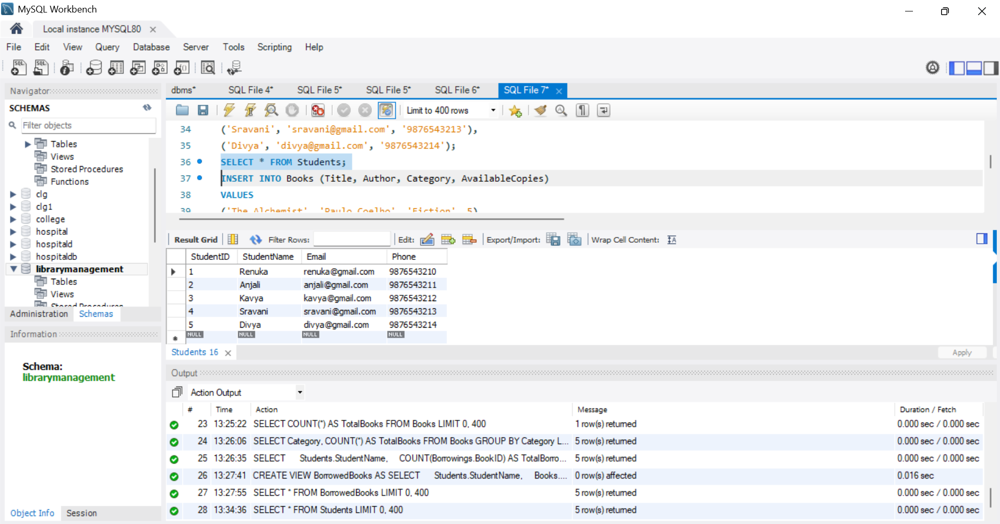
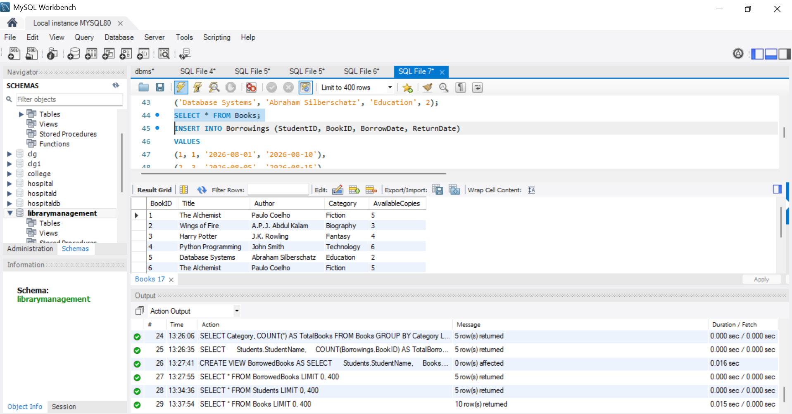
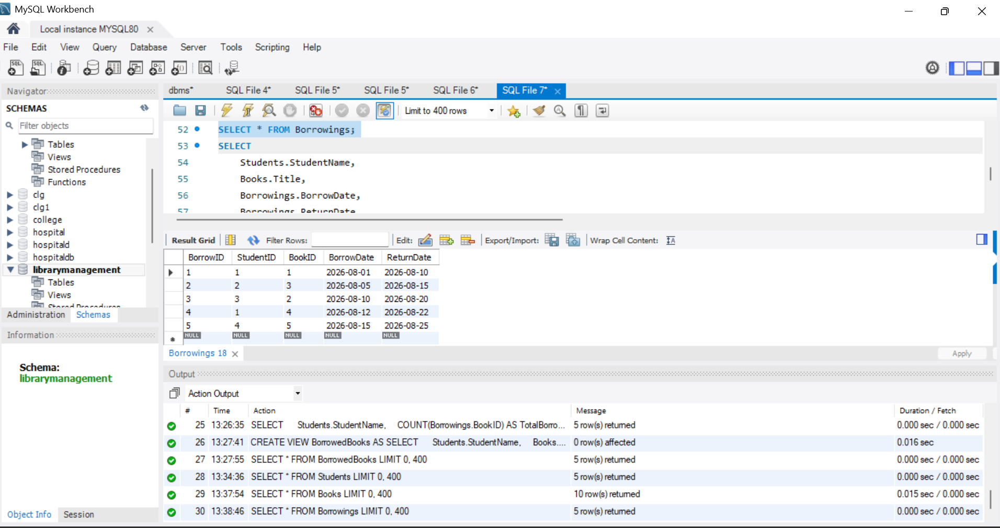
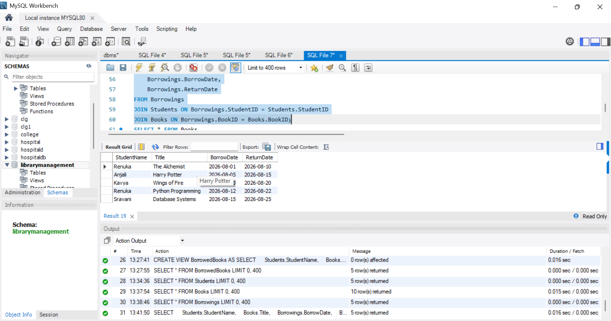

# 📚 Library Management Database

A SQL-based Library Management Database project developed using MySQL. This project is designed to manage and organize library information such as students, books, and borrowing records using relational database concepts.

## 📌 Project Overview

The Library Management Database helps maintain library-related data in a structured and efficient way. It demonstrates the practical implementation of SQL queries, database tables, relationships, constraints, and JOIN operations.

The project focuses on managing:

- Student information
- Book information
- Book borrowing records
- Relationships between database tables
- SQL queries for retrieving useful library information

## 🎯 Objectives

- To design a structured relational database for library management.
- To store student and book information efficiently.
- To maintain book borrowing records.
- To establish relationships between different tables.
- To practice SQL queries and JOIN operations.
- To retrieve meaningful information from the database.

## 🛠️ Technologies Used

- MySQL
- SQL
- MySQL Workbench

## 🗂️ Database Tables

### 1. Students

Stores information about students who use the library.

**Main details include:**
- Student ID
- Student Name
- Other student-related information

### 2. Books

Stores information about books available in the library.

**Main details include:**
- Book ID
- Book Title
- Author
- Book-related information

### 3. Borrowings

Stores information about books borrowed by students.

**Main details include:**
- Borrowing ID
- Student ID
- Book ID
- Borrowing details

## 🔗 Database Relationships

The database uses relationships between the tables to connect students, books, and borrowing records.

For example:

- A student can borrow books.
- A book can be associated with borrowing records.
- The Borrowings table connects Students and Books.

## 💻 SQL Concepts Used

This project demonstrates various SQL and DBMS concepts:

- CREATE DATABASE
- CREATE TABLE
- INSERT
- SELECT
- WHERE
- ORDER BY
- GROUP BY
- Aggregate Functions
- Primary Key
- Foreign Key
- Constraints
- INNER JOIN
- LEFT JOIN
- Relational Database Concepts

## 📊 Sample Operations

The database can be used to perform operations such as:

- Display all students
- Display all available books
- View borrowing records
- Find books borrowed by students
- Retrieve student and book details using JOIN
- Analyze borrowing information using SQL queries

## 📸 Screenshots

### Students Table


### Books Table


### Borrowings Table


### JOIN Query Result


## 📁 Project Structure

```text
Library-Management-Database/
│
├── library_management.sql
├── README.md
│
└── screenshots/
    ├── students.png
    ├── books.png
    ├── borrowings.png
    └── join-query.png
